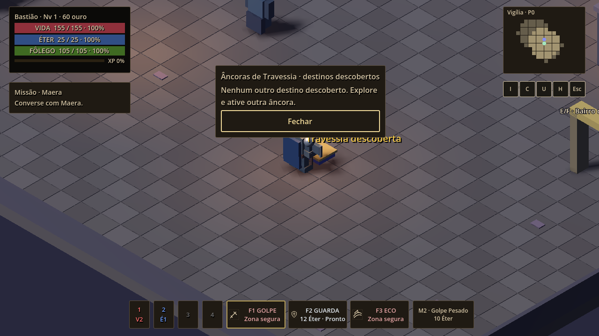

# BUG-US01-03 — Fix03R2: feedback mínimo e regressões

24/10/2026, America/Bahia. Base c871938a249f3e29723d7fc6cef64e724e7a232a; branch audit/us-01-baseline-godot-472; PR #18 Draft. Godot 4.7.2.stable.official.ed1daf0bf.

Autorização: o PO aprovou ajustes mínimos de feedback e regressões, baseline e novo Windows. A reprovação G2 do Fix03R1 continua registrada em [investigação anterior](BUG_US01_03_G2_FALHAS.md). Esta entrega não declara resolução das quatro falhas manuais originais nem aprovação de G2.

## Alteração de produção

Somente src/world/exploration.gd: menu sem outro destino descoberto informa que é necessário explorar e ativar outra âncora; recusas já existentes explicam descoberta, derrota, fonte de outra região, distância, obstrução, progressão ou falha/transição em curso. activate também explica distância/obstrução quando o objeto é âncora. A mensagem de recusa substitui mensagens anteriores de sucesso. Os guards, suas prioridades e os retornos booleanos são preservados; nenhuma nova permissão de viagem foi criada. Os demais objetos mantêm seu comportamento.

Mantidos sem alterações: marca monotônica de dano efetivo inimigo, janela de 5000 ms, predicado chase/search/attack/hit com ameaça, fechamento e modalização, scripts do jogador, inimigos Fix02, save/load, input e regras de navegação. Não se alterou a ordem de processamento nem se prometeu fechamento atômico no mesmo frame.

## Regressões

Nova suíte tests/test_us01_fix03r2_feedback.gd: 13 checks. Descobre o par de âncoras por E/activate reais sem atribuir anchors diretamente, seleciona destino com eventos de mouse e volta com foco/Enter. Verifica estado vazio, descoberta ausente, fonte invisível, distância por clique, HP/modal preservados, transição ocupada, progressão e obstrução por E/chamada direta. A preparação teleporta e controla progressão; remove encontros nos testes de guards não relacionados a combate. Não é playtest humano nem validação de todos os dispositivos.

Os 28 checks originais, 24 da janela e 28 Fix01 não foram editados. Os 23 checks Fix02 são preservados; a revisão de preparação descrita abaixo acrescenta um check de prontidão. Runner passa de 26 para 27 suítes. Mantida a fixture Fix02 com RID privado atribuído após registro na árvore.

A primeira versão da nova fixture falhou em seis checks: a volta ao Bairro reconstruía o encontro autoral, cujo chase tinha prioridade sobre os guards que o teste queria exercitar. A fixture agora remove explicitamente esse encontro depois da volta, sem alterar ou limpar o relógio de dano nem editar produção. A execução focada final passou 13/0.

## Reprodução

```powershell
$engine = 'C:\Users\Sarumano\Documents\Godot_v4.7.2-stable_win64_console.exe'
./tools/build_windows.ps1 -GodotExe $engine -BuildName EchoesOfAethel-US01-Fix03R2-Windows-x64
./tools/smoke_windows.ps1 -Executable "$pwd/teste-fase20/EchoesOfAethel-US01-Fix03R2-Windows-x64.exe"
python tools/audit_baseline.py
python tools/package_windows.py --build-name EchoesOfAethel-US01-Fix03R2-Windows-x64 --archive-name EchoesOfAethel-US01-Fix03R2-Windows-x64.zip
```

Logs e resultados serão anexados em docs/evidence/fix03r2. Link do workflow, commit e hashes do pacote efetivamente publicado constarão na entrega e no PR; o ZIP local pode diferir por seus logs. EXE usa template oficial e PCK externo, portanto o hash do EXE pode coincidir com o anterior apesar de nova exportação.

## Homologação pendente

Repetir os quatro casos manuais com save, região, duas âncoras descobertas, estado interno das ameaças e captura/log. Confirmar mensagens em caso vazio e rejeições, viagem por mouse e teclado, cinco segundos após dano inimigo, ausência de bloqueio apenas por proximidade pacífica e fechamento ao surgir ameaça. Revalidar controles e morte/load já aprovados. A suíte verde não substitui a decisão do PO. Sem merge nem aprovação automática G1/G2.

## Resultado local concluído

Importação limpa e parsing exit 0; grafo sem erros; 27/27 suítes exit 0; feedback 13/0, Fix03 28/0, janela 24/0, Fix01 28/0 e Fix02 23/0. Exportação nova exit 0; EXE smoke 40/0. A engine oficial carregou o PCK novo com o script de feedback externo: 13/0, sem substituir o conteúdo do pack. A instrumentação de 31 snapshots com renderização OpenGL 1280×720 também concluiu exit 0; a captura do estado vazio foi inspecionada e o texto está legível, com foco visível no botão Fechar. Isso é evidência renderizada do PCK, não homologação manual do PO. Auditoria de referências sem arquivos ausentes.



As assinaturas normalizadas de jogador, IA, mundo, visual, regressões Fix01/Fix03 e bloco da janela/predicado foram comparadas com a base c871938: idênticas. A única exceção entre testes é a preparação da fixture Fix02 explicitada abaixo. Evidência em [preserved-contracts.json](evidence/fix03r2/preserved-contracts.json). Os logs mantêm avisos locais de certificados/editor_settings e ObjectDB legados; não houve erro de parsing nem falha no smoke. O CI será executado sobre o commit publicado; resultado final e hashes serão associados ao PR.

## CI intermediário e prontidão da fixture Fix02

Workflow 40058943065, commit a003ee0: feedback 13/0, janela 24/0 e âncoras 28/0 passaram; Fix02 falhou em “agent resumes after map synchronizes”, embora a consulta ao fim retornasse iteração 2/caminho 11. O resultado não foi ignorado. A fixture agora verifica a existência de caminho completo ANTES de iniciar o orçamento de 35 frames, com ator parado e espera limitada a 120 frames de preparação. Acrescenta um check de prontidão; os 23 anteriores, o deslocamento >0,3 m e os 35 frames de movimento continuam iguais. Não atribuir causalidade definitiva apenas ao log anterior: são acrescentados registros de posição, estado e caminho do agente para distinguir preparação e movimento. IA de produção permanece byte a byte preservada. A assinatura anterior da fixture em preserved-contracts.json descreve o primeiro commit R2; a revisão de preparação está explicitamente registrada aqui.

## Complemento de cobertura — fluxo real obrigatório

Conferência do escopo: a única alteração de produção desde c871938 continua em src/world/exploration.gd, somente mensagens e estado vazio. Nenhuma mudança funcional adicional nesta rodada.

A suíte de feedback passa de 13 para 23 checks. Acrescenta abertura/descoberta com F usando o binding existente (sem gravar preferências), viagem pacífica com inimigo próximo e física ativa atrás de obstrução real, perseguição gerada pela IA real sem atribuir ai_state, recusa por E e chamada direta, e fechamento por perseguidor surgido depois da abertura. Mantidos mundo ativo, feedback e liberação do lock. Não se congela IA nesses cenários novos; o obstáculo só pertence à fixture e não bloqueia o acesso à âncora. O setup continua controlado e não substitui o save/roteiro de homologação do PO.

Execução focada: 23 checks/zero falhas. Baseline completa, nova exportação e CI serão repetidos no novo commit; links, hashes e resultado final constarão no PR. Janela de 5 segundos permanece coberta pelos 24 checks anteriores intactos; Fix01 e Fix02 continuam no runner. G1/G2 não aprovados.
