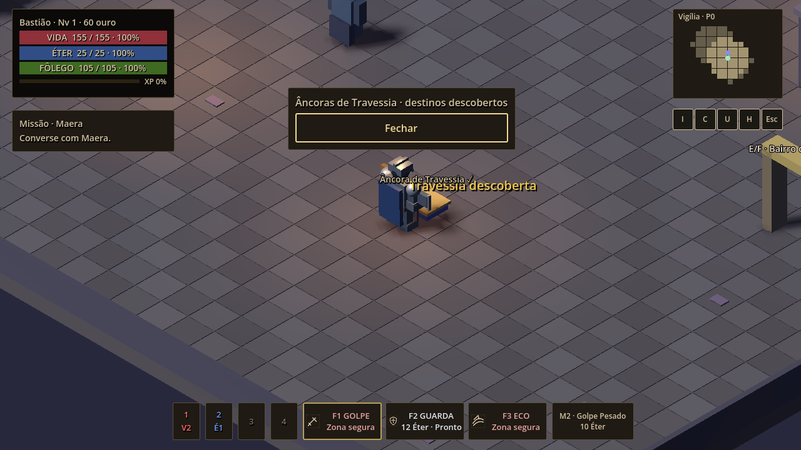
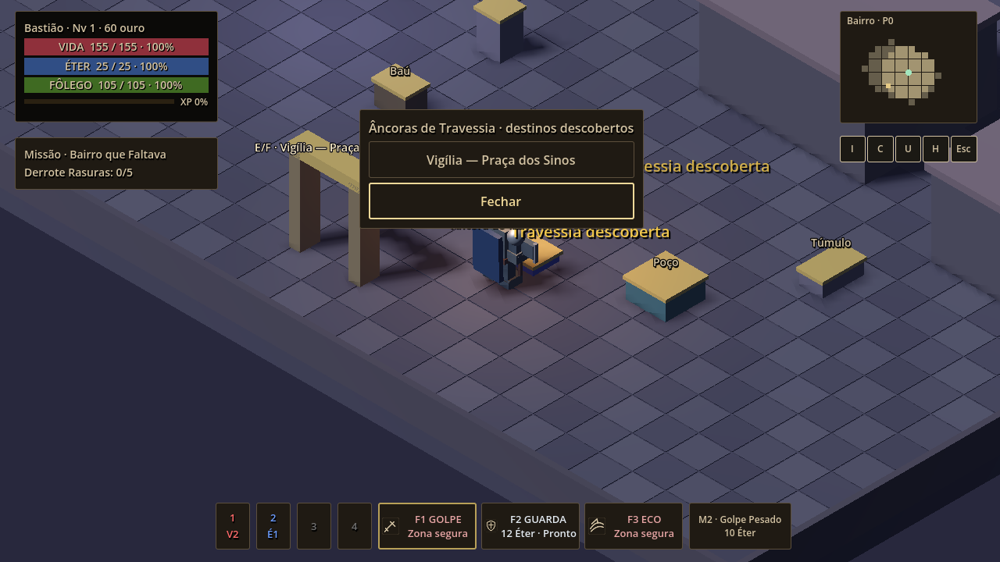
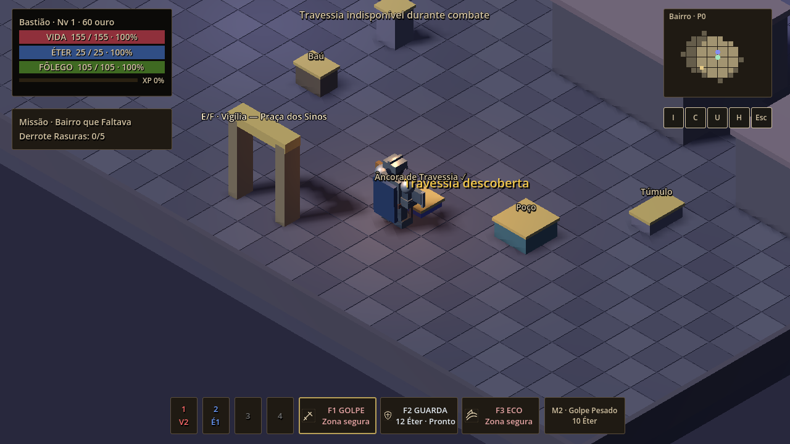

# BUG-US01-03 — G2 reprovado: investigação do Fix03R1

Data: 24/10/2026, America/Bahia. Branch `audit/us-01-baseline-godot-472`. Commit investigado: `c871938a249f3e29723d7fc6cef64e724e7a232a`. PR #18 Draft. Godot `4.7.2.stable.official.ed1daf0bf`, Windows x64.

## Resultado e limite da investigação

**A reprovação oficial do PO permanece válida. Não há Fix03R2 implementado nem G1/G2 aprovado.**

O PO reprovou viagem fora de combate, inimigo próximo pacífico, perseguição ativa e ameaça após abertura. A resposta complementar reiterou “fluxo principal comprometido”, “possível bloqueio indevido” e “restrição/fechamento não validado”, sem região, save, sequência de cliques, vídeo ou logs da sessão. Portanto, não é possível afirmar que as quatro falhas originais foram repetidas exatamente. A investigação abaixo contém reproduções equivalentes controladas, um encontro autoral com IA ativa e achados confirmados de comunicação/temporalidade. Não substitui a sessão de homologação.

**Confirmado:** menu com apenas “Fechar” quando não há outro destino descoberto; rejeições não relacionadas a combate sem explicação específica; perseguidor real fora do enquadramento imediato bloqueando a âncora; defasagem de atualização entre IA e fechamento do painel. **Não confirmado:** falha de clique em destino válido, bloqueio causado exclusivamente por patrol/return pacífico, viagem permitida com chase já registrado ou painel permanecendo aberto indefinidamente após chase.

## Artefato preservado e método

Extraídos somente EXE/PCK do ZIP de CI Fix03R1 já disponível localmente. Originais preservados em `.archive/g2-fix03r1-original/`. Hashes conferidos antes e depois:

| Arquivo publicado | SHA-256 |
|---|---|
| ZIP interno do CI | `178c4cd3c6f9df5edf3d0d918811636a73a9730850b67e54f7d434348ce0ebaf` |
| EXE | `d34d36f3be1a6c49c56525ae86469b92e4f417ddf0b43cf00dd80c385c4b0562` |
| PCK | `9d2cf82d6a25e2e659e216e99ce40a4718a3dcae9c0437826c10a2ab9c9583bd` |

O EXE original executou seu smoke incorporado: **40 checks, zero falhas**, código 0. Esse smoke não valida os quatro casos manuais. Não houve reexportação, substituição do PCK ou novo pacote de gameplay.

O template release oficial restringe `--script`/substituição de caminhos (opções X da ajuda da engine). A tentativa de executar o diagnóstico externo no EXE não produziu traces e não foi contada como reprodução. Para inspecionar os recursos exportados sem modificá-los, a engine oficial 4.7.2 carregou **o PCK original** via `--main-pack` e um SceneTree diagnóstico externo. Isso é instrumentação do PCK, não execução manual do EXE original. O mesmo diagnóstico foi executado no checkout.

Três modos concluídos com código 0 e **31 snapshots por modo**, não “31 testes de aceite”: checkout/headless; engine com PCK/headless; engine com PCK/renderização Windows OpenGL Compatibility 1280×720. Eventos E e cliques entram por `Input.parse_input_event`, passam pela UI e pelos handlers reais. Capturas são frames reais do viewport renderizado com PCK original, sem IA generativa. São cenas montadas pelo diagnóstico, não capturas da sessão do PO.

A preparação teleporta o jogador, atribui progressão de teste e, nos controles isolados, remove encontros ou congela atores. Essas intervenções existem somente no script diagnóstico e são identificadas em cada cenário. A descoberta usa E/activate reais, sem preencher diretamente a lista de âncoras. O caso autoral mantém os cinco inimigos e sua física/IA originais. Saves de teste têm pastas isoladas, sem tocar no save do PO.

## Reprodução por cenário

As coordenadas e HP abaixo vêm do PCK/headless; os resultados finais também ocorreram no checkout e com renderização. Traces completos incluem ID do jogador/alvo, HP, posição, região, distância, LOS, visibilidade, estado, memória, windup, status de navegação, painel, lock, botões e condições de cada âncora.

### 1. Viagem fora de combate

**Passos A (fluxo sem destinos):** novo jogo; posicionar o jogador a 1 m de `vigilia_anchor`, em `(3,0,7)`; pressionar E. Nenhum inimigo. Resultado: HP 155, `map_01`, combate false, painel aberto/lock true, apenas botão “Fechar”. A descoberta da própria fonte não cria outro destino. Esperado pela regra atual: não viajar para destino não descoberto. Problema confirmado de UX: nenhum texto explica por que não há destinos. Não é prova de quebra do predicado de combate.

**Passos B (destino válido):** descobrir Vigília por E; entrar no Bairro com progressão habilitada como preparação; retirar inimigos apenas desta fixture; aproximar-se de `district_anchor` em `(3,0,10)`; E; clicar fisicamente no primeiro botão, cujo texto real é “Vigília — Praça dos Sinos”. Ambas as âncoras descobertas, fonte visível, LOS livre, distância 1 m, sem dano recente. Esperado: viagem ao hub. Observado: `map_02 → map_01`, posição `(3,0,7.4)`, HP `155 → 155`, painel fechado/lock false. **Falha de viagem válida não reproduzida.**

Referências: `01_new_game_after_E`, `02_peaceful_pair_open`, `02_after_first_destination_click`.





### 2. Inimigo próximo, mas pacífico

**Controle isolado:** repetir o par de descobertas; criar ator real a 4 m em `(-1,0,10)`; congelar sua física e manter `patrol`, alvo igual ao jogador, memória 0, windup false. Jogador `(3,0,10)`, HP 155, Bairro. E abre painel; clique no botão do hub conclui viagem a `(3,0,7.4)`, HP 155, painel fechado, lock false. **Proximidade e identidade do alvo sozinhas não bloquearam.**

Essa fixture não comprova um inimigo naturalmente pacífico a 4 m com LOS livre: quando sua física é liberada, a IA Fix02 adquire o jogador. A matriz também registra `return` com alvo persistente sem bloquear. A classificação visual de “pacífico” pelo PO não veio acompanhada do estado interno.

**Encontro real:** entrar no Bairro com os cinco atores autorais ativos; posicionar jogador na âncora `(3,0,10)`; aguardar 60 frames; E. HP 155, sem dano recente. Um ator passa a `chase`, alvo jogador, LOS true, memória 5 s, distância ~14,26 m antes de E e ~14,09 m depois. Outros quatro permanecem em patrol. A câmera mostra a âncora sem esse perseguidor no enquadramento imediato; o menu não abre e aparece “Travessia indisponível durante combate”. O bloqueio é explicado por chase real, não pelo patrol que está mais aparente. Isso é **uma explicação possível**, não identificação da causa da sessão do PO.

Referências: `03_controlled_patrol_open`, `03_controlled_patrol_after_click`, `06_authored_encounter_before_E/after_E`.



### 3. Perseguição ativa

**Passos:** par descoberto, fonte do Bairro a 1 m; ator real a 4 m com `chase` controlado, alvo jogador, HP positivo. Pressionar E. Esperado: impedir abertura e manter mundo ativo. Observado: painel false, lock false, combate true; HP 155, posição `(3,0,10)`, `map_02`; mensagem de indisponibilidade. O encontro autoral descrito acima também nega a abertura com chase produzido pela IA real. A suíte original cobre chamada direta a travel nos estados chase/search/attack.

**Resultado:** não foi reproduzida abertura persistente nem viagem permitida com chase já registrado. A informação do PO “restrição de combate não validada” permanece uma pendência de homologação, não uma reprodução comprovada de bypass. Não houve cenário/registro original suficiente para concluir por que a validação falhou.

Referência: `04_controlled_chase_E`.

### 4. Ameaça após abertura

**Controle isolado:** ator congelado em patrol a 4 m; E abre menu com fonte/destino válidos; mudar somente o estado da fixture para chase. No mesmo frame, painel ainda true e predicado de combate true. Depois de um frame processado, painel false e lock false, com mensagem de combate.

**IA ativa:** recomeçar o controle; abrir menu em patrol congelado; liberar física do ator. Alvo conserva o mesmo ID do jogador. Após um frame, ator em chase a ~3,96 m, memória 5 s, painel ainda true/lock true. Após três frames, chase a ~3,87 m, painel false/lock false, mensagem de combate. HP 155 e posição `(3,0,10)` em `map_02` permanecem iguais.

**Confirmado:** há defasagem transitória: exploração e inimigo não atualizam estado/painel atomicamente no mesmo instante. **Não confirmado:** painel indefinidamente aberto, dano adicional nesses poucos frames ou viagem indevida nessa janela. `travel()` revalida o predicado no clique; não se demonstrou bypass. É inadequado chamar essa observação de correção ou de exploração confirmada. A latência aceitável precisa constar do roteiro de aceite.

Referências: `05_before_threat`, `05_same_frame_after_threat`, `05_one_frame_after_threat`, `05_live_before_threat`, `05_live_after_one_frame`, `05_live_after_three_frames`.

## Outras condições e feedback

| Preparação diagnóstica | Resultado efetivo | Registro |
|---|---|---|
| Chamada direta a destino não descoberto | false; painel continua aberto; sem mensagem específica | `09_undiscovered_destination` |
| Fonte de outra região, invisível | false; sem mensagem específica | `09_invisible_source` |
| Após abrir, deslocar artificialmente a 3 m e clicar destino | Não viaja; painel aberto/lock true; HP 155, Bairro `(3,0,12)`; mensagem vazia | `09_out_of_reach_destination_click` |
| Duas âncoras descobertas, mas desabilitar artificialmente quest_started no hub e clicar Bairro | Não viaja; painel aberto; mantém mensagem anterior de travessia, sem explicar progressão | `09_progression_destination_click` |
| Colocar obstáculo de teste entre jogador e âncora; E a 1 m | reachable false; painel fechado/lock false; HP 155; sem feedback específico | `09_occluded_source_E` |

Os casos de deslocamento com modal e progressão incompatível foram criados artificialmente para exercitar guards, não observados no fluxo normal do PO. A lista só mostra destinos já descobertos; não exige que o destino esteja visível na região atual. É a **fonte** que precisa estar visível, próxima e acessível. Não há evidência de que visibilidade falsa do destino explique a falha válida.

## Estados, alvo e persistência

A matriz controlada mantém o mesmo ator/ID de alvo entre estados. `patrol` e `return` não bloqueiam; `chase`, `search` e `attack` bloqueiam; `hit` bloqueia com search_remaining > 0 e não bloqueia sem essa memória. Windup é um bloqueio independente. Mudar apenas o alvo para null faz chase deixar de bloquear; isso é controle artificial, não alvo nulo encontrado em produção. Não se confirmou alvo residual de jogador anterior após load.

O predicado ignora atores inválidos, em exclusão ou mortos. Não exige LOS atual nem presença na tela: search mantém ameaça lembrada. Um ator artificialmente ocultado com chase e alvo jogador continua bloqueando, por construção do predicado. Isso demonstra a possibilidade de ameaça invisível no classificador, não um ator ocultado indevidamente encontrado no save do PO. Não se propõe cortar ameaça por LOS ou por raio, pois isso alteraria a regra aprovada e/ou interferiria na IA Fix02.

Na transição válida, a lista de inimigos é limpa e o painel fechado por update_region. Nos traces não se encontrou bloqueio residual depois da viagem. A janela monotônica de dano foi preservada; a nova investigação não altera sua duração, origem ou persistência.

## Causa confirmada versus hipóteses

1. **Confirmado — comunicação incompleta:** open_travel exclui a fonte da lista e não tem estado vazio; travel/activate retornam false silenciosamente em vários guards. Isso explica os sintomas reproduzidos de menu sem opção ou clique sem resposta, mas ainda não associa esses sintomas à sessão original.
2. **Confirmado — ameaça fora do enquadramento:** há chase real no encontro autoral enquanto a âncora parece calma na captura. Não é falso positivo por patrol.
3. **Confirmado — ordenação:** o tick da exploração e a física dos atores permitem painel visível durante a mudança de patrol para chase até o tick seguinte observado. Não se confirmou viagem indevida.
4. **Não comprovado:** PCK diferente do informado na máquina do PO; destinos ainda não descobertos; save com progressão incompatível; ameaça residual após load; prioridade E/F sobre outro objeto/conector; interferência de outro modal, resolução ou foco. Necessitam save, âncora, ação exata e captura/log da sessão. Não atribuir causa a essas hipóteses por exclusão.

## Lacunas dos testes anteriores

- Os 28 checks Fix03 preenchem diretamente três destinos, removem o encontro autoral e controlam estados/physics. A viagem pacífica chama travel diretamente, sem selecionar o botão de destino pelo mouse. Isso comprova o predicado isolado, não o percurso de descoberta/UI do jogador.
- O teste com IA real espera 12 frames após spawn; não mede a latência intermediária de um frame entre chase e painel. Não compara ator observado pelo PO com todos os demais alvos ativos.
- A fixture de 24 checks testa a janela e seu término real, mas não cobre menu vazio nem explicações de retorno false.
- Phase25 GUI clica num destino real, mas depois de eliminar o encontro. O smoke incorporado de 40 checks não é uma reprodução completa das quatro reprovações.
- Uma indicação visual pacífica não era confrontada com ID de alvo, LOS, memória e outros perseguidores fora da câmera. Nenhum desses testes autoriza aprovação automática de G2.

Nesta rodada, os 28 checks originais e os 24 da janela foram reexecutados sem alteração: ambos exit 0/zero falhas. Isso é confronto com as fixtures, **não refutação da reprovação manual**. Não foi solicitada nem executada uma nova baseline integral de produção ou novo build, pois não houve correção funcional.

## Proposta mínima para Fix03R2 — ainda não implementada

1. Após autorização do PO, explicar o estado sem destinos e cada recusa de viagem com motivo legível (descoberta, fonte/distância/obstrução, progressão, transição ou combate), reaproveitando o fluxo existente. Preservar os guards e o predicado aprovados. Evitar mensagem de travessia anterior parecer resultado do clique rejeitado.
2. Acrescentar regressões permanentes de descoberta por E/F, seleção por clique/foco e motivos de rejeição, sem preencher anchors diretamente no teste principal. Manter os checks existentes como testes unitários de política.
3. Documentar ameaça ativa no roteiro de homologação com ID/estado do ator, incluindo perseguidor fora do enquadramento. Não tornar um inimigo pacífico por esconder ou congelar a IA em um playtest de aceite.
4. Só propor mudança de ordenação/fechamento se o PO exigir latência menor que o tick observado, ou se for capturado um painel que permanece aberto. Só alterar o predicado se houver um bloqueio indevido concretamente identificado e nova autorização. Não reduzir o raio, ignorar search ou mudar IA para fazer a âncora funcionar.

A prioridade é reproduzir o fluxo principal no save/região do PO antes de escolher uma correção comportamental. As melhorias de feedback acima não devem ser anunciadas como correção comprovada de todas as quatro falhas.

## Critérios de aceite manual de Fix03R2

- Registrar hash do PCK/EXE, save utilizado, resolução, região, fonte/destino e método (E/F, clique, teclado). Descobrir duas âncoras pelo fluxo real com progressão válida.
- Fora de combate e após os cinco segundos aprovados: abrir fonte a até 2,5 m e selecionar destino por mouse e teclado. Confirmar região/posição de chegada, painel fechado e controles restaurados. Sem destinos: explicação inequívoca, sem promessa de viagem.
- Pacífico: provar estado patrol/return sem windup, sem dano recente e sem outros alvos em chase/search/attack/hit com memória. Proximidade sozinha não bloqueia. IA permanece ativa durante o aceite.
- Perseguição: confirmar pelo registro o alvo jogador e chase ativo; tentativa por E/F e mouse deve ser rejeitada com feedback, sem deslocar região. Chamada direta também deve respeitar o predicado.
- Ameaça após abertura: abrir em paz, introduzir perseguidor real e registrar frames; painel deve fechar/liberar somente seu lock, mantendo mundo ativo. Registrar a latência e confrontar com o limite aceito pelo PO; tentar selecionar destino ao surgir ameaça e confirmar ausência de viagem proibida.
- Diferenciar recusa por combate das recusas por descoberta/distância/obstrução/progressão. Revalidar os cenários já aprovados de cinco segundos, controles, morte/load para garantir preservação, sem redesenhar essas regras.
- Persistindo falha, anexar log/clip e snapshot antes/depois; suite headless verde não encerra a reprovação. PO decide G1/G2.

## Evidências e reprodução técnica

- [Comparação estruturada dos três modos](evidence/fix03r1-g2/comparison.json).
- [Trace completo do PCK/headless](evidence/fix03r1-g2/pck-engine-headless/trace.json).
- [Trace completo do PCK/renderizado](evidence/fix03r1-g2/pck-engine-render/trace.json).
- [Log do EXE original](evidence/fix03r1-g2/original-exe-smoke.log).
- [Fix03 original reexecutado](evidence/fix03r1-g2/existing-fix03.log) e [janela de dano reexecutada](evidence/fix03r1-g2/existing-damage.log).
- [Hashes das evidências](evidence/fix03r1-g2/SHA256.json).
- Script: `tests/diagnose_us01_03_g2.gd`. Não incluído no runner de aceite e não é script de produção.

Exemplo, a partir do checkout, com EXE/PCK extraídos sem modificação:

```powershell
$engine = 'C:\Users\Sarumano\Documents\Godot_v4.7.2-stable_win64_console.exe'
$env:AETHEL_TEST_SAVE_DIR = "$pwd/relatorios-fase20/g2-investigation/repro-profile"
$env:AETHEL_G2_EVIDENCE = "$pwd/relatorios-fase20/g2-investigation/repro"
New-Item -ItemType Directory $env:AETHEL_TEST_SAVE_DIR,$env:AETHEL_G2_EVIDENCE -Force
& $engine --headless --fixed-fps 60 --quit-after 4000 --main-pack "$pwd/.archive/g2-fix03r1-original/EchoesOfAethel-US01-Fix03R1-Windows-x64.pck" --script "$pwd/tests/diagnose_us01_03_g2.gd" --log-file "$env:AETHEL_G2_EVIDENCE/engine.log"
# Checkout: substituir --main-pack pelo argumento --path .
# Renderizar: retirar --headless e adicionar --rendering-method gl_compatibility --audio-driver Dummy --resolution 1280x720
```

Alguns logs contêm aviso de certificados do Windows e ObjectDB no encerramento; os marcadores de conclusão e códigos de saída foram conferidos. A primeira tentativa do diagnóstico no checkout parou antes dos traces e foi encerrada; não foi usada como resultado. Os três conjuntos completos finais têm 31 snapshots cada. Nenhum script de produção, regra de cinco segundos, input modal, save/load, IA, balanceamento, missão ou placeholder foi alterado. Nenhuma nova geração, merge ou aprovação de G1/G2.

**Encerramento:** investigação entregue; aguardar autorização explícita do PO para alterações funcionais. A causa das quatro reprovações originais permanece parcialmente indeterminada até obter uma reprodução da sessão original.
